<picture>
  <source media="(prefers-color-scheme: dark)" srcset="./assets/fathom-hero-dark.svg">
  
</picture>

<b>Aswin Salish</b> · AI-Based App Developer | Assistive Technology Developer | Creative Thinker

   

#### Dive log

<picture>
  <source media="(prefers-color-scheme: dark)" srcset="./assets/fathom-log-dark.svg">
  
</picture>

Reading the dive log

- **Depth:** one metre per contribution in the last 12 months. 475 m puts you in the twilight zone. The zones are the ocean’s real ones: sunlit to 200 m, twilight to 1,000 m, midnight to 4,000 m, abyssal to 6,000 m and hadal below that, down to the Challenger Deep at 10,935 m.
- **The descent:** your year as one dive, left to right. The line drops as contributions add up and runs flat through breaks. Each bubble is an active day; bigger bubbles are busier days. You reached the twilight zone on May 25.
- **Logbook:** bottom time is active days, longest dive is the longest streak, safety stop is the longest break, visibility is followers, treasure is stars, and time in the water is years on GitHub.
- **Species spotted:** language share by bytes across public repositories. The Latin is made up.
- **On sonar:** featured repositories. The nearer the centre, the more stars.
- **The opening shot:** the reef is the last 52 weeks, one coral per week. Taller corals are busier weeks, and each glowing polyp is one active day. The fish are featured repositories, sized by stars.

Artwork: original animated SVG, generated by README Templates · template: Fathom. Motion stops if your system asks for reduced motion.

#### Sightings

- **[Portfolio](https://github.com/aswinsalishgit/Portfolio)** · Personal Portfolio Website (aswinsalish.me) – A showcase of my projects, technical skills, and professional journey. Built to highlight my work in Android development and AI integration.  
  TypeScript
- **[Buffer](https://github.com/aswinsalishgit/Buffer)** · Buffer is a high-level, simultaneous-reveal state machine game for Android. Built with Kotlin and Jetpack Compose, featuring algorithmic opponent prediction and a dynamic 2-round cooldown memory mechanic. Download the APK in Releases!  
  Kotlin
- **[CodeGab-AceLC](https://github.com/aswinsalishgit/CodeGab-AceLC)** · Automatically upload your accepted LeetCode solutions to GitHub with ease. An open-source Chrome extension by CodeGab.  
  JavaScript
- **[PEZREQ](https://github.com/aswinsalishgit/PEZREQ)** · A premium digital catalogue for designer jewellery, showcasing curated collections through an elegant and immersive web experience.  
  TypeScript

<picture>
  <source media="(prefers-color-scheme: dark)" srcset="./assets/fathom-end-dark.svg">
  
</picture>

