  <picture>
    <source media="(prefers-color-scheme: dark)" srcset="./assets/swiss-poster-dark.svg">
    
  </picture>

&nbsp;&nbsp;&nbsp;

&nbsp;&nbsp;&nbsp;

&nbsp;&nbsp;&nbsp;

#### Index

  <picture>
    <source media="(prefers-color-scheme: dark)" srcset="./assets/swiss-index-dark.svg">
    
  </picture>

  
Key

  - **The figure** on the poster is your contributions in the last twelve months. The bars along its foot are the 52 weeks, with the busiest in red.
  - **Index:** the year in numbers, language share by bytes across public repositories, and contributions per calendar month (numbered 01 to 12).

  Artwork: original animated SVG, generated by README Templates · template: Swiss. Motion stops if your system asks for reduced motion.

#### Selected work

- `01` **[Portfolio](https://github.com/aswinsalishgit/Portfolio)** — Personal Portfolio Website (aswinsalish.me) – A showcase of my projects, technical skills, and professional journey. Built to highlight my work in Android development and AI integration.
  TypeScript

- `02` **[Buffer](https://github.com/aswinsalishgit/Buffer)** — Buffer is a high-level, simultaneous-reveal state machine game for Android. Built with Kotlin and Jetpack Compose, featuring algorithmic opponent prediction and a dynamic 2-round cooldown memory mechanic. Download the APK in Releases!
  Kotlin

- `03` **[CodeGab-AceLC](https://github.com/aswinsalishgit/CodeGab-AceLC)** — Automatically upload your accepted LeetCode solutions to GitHub with ease. An open-source Chrome extension by CodeGab.
  JavaScript

- `04` **[PEZREQ](https://github.com/aswinsalishgit/PEZREQ)** — A premium digital catalogue for designer jewellery, showcasing curated collections through an elegant and immersive web experience.
  TypeScript

  <picture>
    <source media="(prefers-color-scheme: dark)" srcset="./assets/swiss-closing-dark.svg">
    
  </picture>

